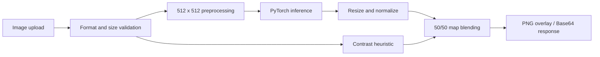

# Heatmap

**A visual-attention prediction service for interface screenshots.**

Heatmap turns an uploaded image into a saliency overlay through a FastAPI service and a PyTorch model. Extracted from a larger application, this repository presents the inference pipeline and the surviving experimental evidence in one place.

> Predicted saliency is a model estimate, not measured eye tracking, a click heatmap, or a prediction of first fixation. The final overlay also includes a contrast heuristic.

## Engineering highlights

- ResNet-34 encoder with a U-Net-style decoder and five input channels.
- Lazy, cached model initialization and automatic CPU/CUDA selection.
- Image-format, upload-size and image-dimension validation.
- Request IDs, optional structured logging and a cached inference health check.
- Archived model comparisons and load-test summaries, with explicit limits on interpretation.



## Run locally

The local extraction includes an ignored checkpoint in `models/websaliency_model.pth`. **A Git clone does not include model weights.** See [checkpoint availability](models/README.md).

Install the existing dependencies in a virtual environment:

```bash
python -m venv .venv
# Linux/macOS: source .venv/bin/activate
# Windows PowerShell: .venv\Scripts\Activate.ps1
pip install -r requirements.txt
uvicorn src.api:app --host 127.0.0.1 --port 8002
```

Open `http://127.0.0.1:8002/docs` for the interactive upload interface. The original application UI depends on a private component library and is not part of this extraction.

```bash
curl -X POST http://127.0.0.1:8002/api/heatmap -F "file=@screenshot.png"
curl http://127.0.0.1:8002/health
```

The upload response contains `blended_png_base64`: a Base64-encoded PNG. The health endpoint returns model status and performs cached inference.

## Docker

```bash
docker build -t heatmap .
docker run --rm -p 8002:8002 -v "${PWD}/models:/app/models:ro" heatmap
```

Run from the repository root with a compatible checkpoint in `models/`. Dependencies are inherited from the source service and are not pinned; the container build has not yet been verified.

## Configuration

| Variable | Default | Purpose |
|---|---|---|
| `MAX_FILE_SIZE` | `10485760` | Upload limit in bytes |
| `MAX_IMAGE_DIMENSION` | `4096` | Maximum width or height |
| `ENVIRONMENT` | `development` | Error-detail policy |
| `HEALTH_CHECK_CACHE_TTL` | `60` | Inference health cache, seconds |
| `LOG_LEVEL` | `INFO` | Logging level |
| `LOG_JSON_FORMAT` | `false` | Structured JSON logs |

PNG, JPEG and WebP are supported. The service resizes input to a square rather than preserving its aspect ratio.

## Experiments

The archive contains two quality tables and seven load-test summaries. See [experimental evidence](docs/experiments.md) before comparing numbers. Training data, experiment runners, hardware details and complete evaluation protocols are not included, so these are historical results rather than independently reproduced benchmarks.

## Tests and current status

```bash
pip install -r requirements-test.txt
python -m pytest tests -q
```

All 12 tests pass in the verified Windows/Python 3.12 environment. The inherited tests were corrected to override FastAPI dependencies properly and expect the service's domain exception. Real checkpoint inference was verified separately. See [verification and known gaps](docs/status.md).

## Repository layout

```text
src/                 API, model, inference, validation and logging
tests/               Original service tests
benchmarks/quality/  Archived aggregate model metrics
benchmarks/load/     Archived aggregate load-test statistics
models/              Local checkpoint (ignored by Git)
docs/                Evidence, provenance and verification limits
```

## Attribution and reuse

See [provenance](docs/provenance.md). No open-source license is assigned in this extraction; publication and reuse permissions must be established before release. Third-party model implementations, datasets and weights are not redistributed in Git.
